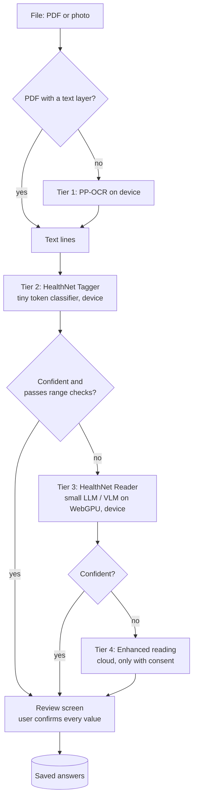

# On-device model roadmap

**Status:** design, not built yet · **Written:** October 2026 · **Owner:** HealthNet team

HealthNet's long-term privacy goal is simple to state: **a person's health data never has to leave their device to be useful.** The app ships *models* to the device and receives *nothing* back unless the person explicitly chooses to share. This document explains how to get there from what exists today. It covers which models to use, how to train them without collecting real health records, how to ship model updates safely, and how to prove each step is better than the last.

---

## 1. Where we are today

Version 1 already does a lot on the device. The table shows each stage and where it runs.

| Stage | How it works today | Runs on |
|---|---|---|
| Reading digital PDFs | pdf.js text layer (`src/ocr/readDocument.js`) | Device |
| Reading photos and scans | PP-OCRv6 tiny via `ppu-paddle-ocr` + onnxruntime-web (~6 MB) | Device |
| Turning lab text into values | Hand-written rules + dictionary (`src/ocr/labParser.js`, `labDictionary.js`) | Device |
| Turning prescription text into medicines | Hand-written rules (`src/ocr/prescriptionParser.js`) | Device |
| Unit conversion and range checks | `src/lib/units.js`, `sections.js` limits | Device |
| Hard documents (messy photos, handwriting) | Opt-in "Enhanced reading": Claude or Gemini (`extraction/providers.py`) | **Cloud, with consent per file** |
| Medicine name matching | RxNorm via `/drugs/match` (only the medicine word is sent) | Server → NLM |
| Risk scores | Python risk engine (`risk/`, `/risk/assessment`) | **Server** |
| Food search, barcodes | USDA / Open Food Facts via `/food/*` (only search words) | Server → third party |
| Storage | Firestore (encrypted at rest by Google, readable by the project) | Cloud |

Two observations shape the roadmap:

1. **The weakest on-device link is structure, not OCR.** PP-OCR reads printed lab reports well. The rules then have to decide which number belongs to which test, and which unit applies. Every new lab layout can break them. That's where a small model helps most.
2. **"Data stays on the device" is not true yet even without the cloud reader.** The risk engine runs on the server, so the health profile is sent there on every score refresh. It isn't stored, but it is sent. Section 6 fixes this, and it is cheaper than any model work.

---

## 2. Target architecture

A tiered pipeline. Each document goes to the cheapest tier that can read it confidently, and cloud reading stays an opt-in last resort.



**Principles**

- **One output contract.** Every tier produces the schema that cloud reading already uses: `LAB_SCHEMA`, `PRESCRIPTION_SCHEMA` and `MEAL_SCHEMA` in `FINAL YEAR PROJECT/extraction/schemas.py`. The review dialogs (`ImportReportDialog`, `PrescriptionDialog`) and `labItemsFromCloud` therefore stay unchanged. A model is a drop-in replacement for a parser, never a new UI.
- **Models transcribe; code validates.** Unit conversion, plausible ranges, the RxNorm check and the "user must confirm" step stay deterministic code after every model. A model can be wrong, but it can never save a value on its own.
- **Graceful degradation.** A device without WebGPU, or with little memory or storage, uses the tiers it can run. Nothing gets worse for anyone: today's rules remain the floor.
- **Off the main thread.** All inference runs in a Web Worker, so the page never freezes.

---

## 3. Model choices

### 3.1 Recommendation: three small models, added in order

| Tier | Job | Recommended approach | Approx. size | Why |
|---|---|---|---|---|
| 2 | **HealthNet Tagger**: label each OCR token as test name / value / unit / reference range / other, and link them | A small **encoder** (BERT-class, 4–30M params) fine-tuned for token classification, with each token's position on the page as an extra feature. Export to ONNX, int8. | **5–30 MB** | Fixes the real failure mode (structure), runs on WASM on any phone in milliseconds, and *cannot hallucinate* text that isn't on the page, because it only labels existing tokens. |
| 3 | **HealthNet Reader**: long-tail layouts, unusual wording, multi-column reports, prescriptions with free text | A small **decoder LLM** (0.5–1B params, 4-bit) fine-tuned to turn OCR lines into the JSON schema, with grammar-constrained decoding so the output is always valid JSON | **~0.4–0.8 GB** | Handles what labels alone can't, such as "Glucose (F)" meaning fasting, or values split across lines. Text-only models are far smaller than vision ones. |
| 3b | **HealthNet Vision**: photos where OCR itself fails (glare, folds, handwriting) | A small **vision-language model** (≤1B where possible) fine-tuned on the same schema | **~0.6–2.5 GB** | The only on-device route for handwriting. Optional download, WebGPU devices only. |

**Why not one big model?** A single 4B vision model such as MedGemma would be simpler to describe but worse in practice:

- it is a multi-gigabyte download;
- most phones can't run it in a browser;
- it is slow;
- it can invent values.

The tiered approach gives most users a 20 MB upgrade over today's rules, and only people who need it download more.

### 3.2 Candidate models (October 2026)

Check sizes, licences and runtime support again at build time; this area moves monthly.

| Model | Params | Type | Licence | Notes for HealthNet |
|---|---|---|---|---|
| PP-OCRv6 tiny (in use) | small | OCR | Apache-2.0 | Keep as Tier 1. |
| BERT-tiny / MiniLM-class encoders | 4–30M | Encoder | Apache-2.0 / MIT (varies by checkpoint) | Base for the Tagger. Avoid LayoutLMv3: its weights are licensed CC BY-NC-SA (non-commercial). |
| Qwen3 0.6B / SmolLM-class | 0.36–0.6B | Text LLM | Apache-2.0 | Base for the Reader. Small enough for WebGPU and WebLLM-style runtimes. |
| Gemma 3 1B | 1B | Text LLM | Gemma Terms of Use | Strong at its size; the licence is permissive but not OSI-approved. Read it before shipping. |
| PaddleOCR-VL 1.5 | 0.9B | Document VLM | Apache-2.0 | Released Jan 2026; strong on OmniDocBench. No official browser build found yet; candidate for Tier 3b if one appears. |
| SmolVLM / SmolVLM2 | 0.25–2.2B | VLM | Apache-2.0 | Supported again in Transformers.js 4.1. Smallest browser-ready VLM route. |
| Gemma 4 E2B | 2.3B effective (5.1B with embeddings) | VLM + audio | Gemma Terms of Use | On-device model from Apr 2026; the LiteRT build is about 2.6 GB. Too large for most browsers today; good for a future native app. |
| MedGemma 1.5 4B | 4B | Medical VLM | Health AI Developer Foundations terms | Google lists lab-report extraction as a use. An int8 on-device build is ~3.6 GB, too big for the web. **Use it as a teacher** (section 4.3), not on the device. |

### 3.3 Runtimes

| Runtime | Use it for | Notes |
|---|---|---|
| **onnxruntime-web** (in use, 1.30) | Tagger (WASM, any device) | Already bundled for PP-OCR, so the Tagger adds no new runtime. |
| **Transformers.js 4.x** | Reader and Vision models | Rewritten WebGPU runtime in 4.0 (Mar 2026); Safari 26+ WebGPU support since 4.3. |
| **WebLLM** (MLC) | Alternative for the Reader | Built for LLMs in the browser, with JSON-schema constrained output. Compare it with Transformers.js on speed and memory in R3. |
| LiteRT / MediaPipe | A future native mobile app | Where Gemma 4 E2B and MedGemma int4 builds already exist. |

**WebGPU availability.** WebGPU is in Chrome/Edge (desktop and Android 12+), Safari 26 on macOS/iOS/iPadOS, and Firefox on Windows and Apple-silicon Macs, with Linux and Android still rolling out. Users without it keep Tiers 1–2 (WASM), which is why the Tagger comes first.

---

## 4. Training without collecting real health records

### 4.1 Stage 1: synthetic data (no personal data at all)

HealthNet already contains everything needed to generate realistic training data:

- `labDictionary.js`: test names, synonyms, LOINC codes and units;
- `sections.js`: plausible value ranges;
- `units.js`: conversions between mg/dL and mmol/L, and so on.

A **synthetic report generator** (Python, kept in the repo, e.g. `FINAL YEAR PROJECT/training/synth/`) would:

1. **Sample a patient's values** from realistic distributions, including out-of-range and borderline cases, and both unit systems.
2. **Lay them out in many styles:**
   - one-column and multi-column;
   - tables with and without borders;
   - "Test / Result / Unit / Range" columns in different orders;
   - footnotes and page headers;
   - lab branding, using fictional lab names only;
   - typical abbreviations and the confusing near-misses the parser already excludes, such as "Non-HDL" and "LDL/HDL ratio".
3. **Render to PDF and to images,** then degrade the images like phone photos: blur, perspective, shadows, JPEG artefacts, creases.
4. **Run Tier 1 OCR on the images,** so the training text has *real* OCR mistakes, the same ones the app will see.
5. **Write the ground truth automatically:** the exact schema JSON and a label for every token.

The same approach works for prescriptions, drawing drug names from the free RxNorm prescribable list, plus doses, frequencies ("1-0-1", "BD", "twice daily") and instructions.

This yields tens of thousands of perfectly labelled examples for free, with zero privacy risk. It also means the project can publish its training data.

### 4.2 Stage 2: made-up real paper

A small set (100–300) of **printed and photographed made-up documents** from different printers, phones and lighting conditions. These catch problems that synthetic rendering misses. They are created by the team; no real patient documents are used.

### 4.3 Stage 3: teacher models for the long tail (optional)

A larger model labels harder synthetic or made-up examples for the small models to learn from (distillation):

- **MedGemma 1.5 4B** runs free on a GPU (Colab, Kaggle, or a university machine).
- The **Enhanced reading** providers cost a few dollars per thousand pages; the README has prices.

Teacher labels are checked by the same validators as everything else, and disagreements go to a human.

### 4.4 Stage 4: opt-in "Help improve HealthNet" (real data, carefully)

The review screen already produces a valuable signal: **what the model read, and what the person corrected it to.** With explicit consent, those pairs become training data.

| Safeguard | How |
|---|---|
| Off by default | A separate switch in Settings, plus a clear explanation; never bundled with other consent. |
| Minimum data | Only the matched lines are shared (e.g. `HbA1c 6.1 %` → corrected `6.4`), never the whole document or image. |
| De-identified on the device | Names, dates of birth, IDs, addresses, phone numbers, lab names and doctor names are removed in the browser before anything is sent. Lines that look like identifiers are dropped. |
| Separate storage | Its own Firestore collection or bucket, not linked to the account uid (random contributor id), with a retention limit. |
| Withdrawal | "Delete my contributions" button; contributions are keyed by the random id stored on the device. |
| Consent record | Version of the consent text, date, and what was shared. |
| Approval first | For a university project: **ethics committee approval before collecting anything.** For a public product: a Data Protection Impact Assessment (GDPR art. 35), plus HIPAA analysis if US covered entities are involved. |

### 4.5 Stage 5: federated learning (research track)

**What it is:** devices fine-tune locally and only send model updates (with secure aggregation and differential privacy), never the data. This is the strongest form of the "only updates" idea.

**Why it's last:**
- Browser-based federated learning is still immature: frameworks such as Flower target Python and native clients, and browser work like WebFed is mostly academic.
- Health-grade privacy budgets are hard to set well.
- It needs many active devices to be useful.

**How to start:** a small simulated study (e.g. Flower with DP-SGD on synthetic data split into fake "devices"), as a research extension or dissertation chapter, before any production use.

---

## 5. Shipping model updates safely

This is how "we can only give updates to the model" works in practice.

**Model manifest.** A small JSON file hosted next to the app:

```json
{
  "id": "healthnet-tagger",
  "version": "1.2.0",
  "minAppVersion": "2.4.0",
  "files": [{ "path": "tagger-int8.onnx", "bytes": 18234112, "sha256": "…" }],
  "schema": "LAB_SCHEMA@1",
  "eval": { "fieldF1": 0.97, "dangerousErrorRate": 0.0004, "testSet": "synth-v7 + paper-v2" },
  "rollout": 0.25,
  "signature": "ed25519:…"
}
```

**Download and storage**
- Model files are hosted on a static CDN or Hugging Face (free) and stored in the browser's Cache Storage or OPFS.
- Downloads happen only after the user agrees, showing the size. "Wi-Fi only" is the default for anything over 50 MB.
- `navigator.storage.estimate()` is checked first, and the app asks for persistent storage so the browser doesn't evict models.

**Integrity**
- The manifest is **signed** (Ed25519). The app ships the public key and verifies the signature with WebCrypto.
- Each file's SHA-256 is checked before loading. A tampered or corrupted model is never run.

**Rollout**
- Staged rollout by percentage, with a server-side kill switch that only stops downloads.
- The previous version is kept until the new one passes a quick self-test on built-in sample text. On failure, the app rolls back automatically.

**No data back**
- The update check sends only the app and model versions.
- No crash logs, no inputs and no outputs are sent unless the person opts into section 4.4.

**Compatibility**
- The manifest names the output schema version. If an old app gets a new model, or the reverse, the app falls back to the previous tier rather than misreading.

---

## 6. End-to-end privacy beyond the models

Models are only part of the promise. These changes give the biggest privacy gain per hour of work.

| Change | Effect | Effort |
|---|---|---|
| **Port the risk engine to JavaScript** | Scores are computed on the device; `/risk/assessment` becomes optional. The engine is ~830 lines of Python plus JSON coefficient files, already validated against reference cases (98 WHO cases to 1e-13). Keep Python as the reference implementation, and add a CI test that runs both on the same fixtures and requires identical results. Export the experimental logistic-regression model's coefficients and scaler to JSON so it needs no scikit-learn. | ~1–2 weeks |
| **Optional end-to-end encrypted storage** | A "private mode" encrypts answers, results, food and activity with AES-GCM in the browser before saving to Firestore. The key comes from a passphrase via PBKDF2/Argon2 and is never sent. Trade-offs: a forgotten passphrase means lost data (offer a printable recovery key), and the server can't run anything on the data, which is fine once the risk engine runs locally. | ~2 weeks |
| **Offline medicine list** | Ship a compressed subset of RxNorm prescribable names (and common INN names) so most matches need no network; ask RxNav only for misses, and only with the single word. | ~1 week |
| **Offline common foods** | Bundle ~2,000 common foods from USDA's public-domain data; search the network only when there's no local match. | ~1 week |

After these changes, a person who never turns on Enhanced reading or wearables would send **no health data to any server except their own encrypted storage.**

---

## 7. Measuring quality: every model must beat what it replaces

### 7.1 Metrics

| Metric | What it catches |
|---|---|
| Field precision / recall / F1 | Missed or invented tests |
| Value exact match (after unit conversion) | Wrong numbers |
| Unit accuracy | mg/dL vs mmol/L mistakes, which are clinically dangerous |
| **Dangerous error rate** | A wrong value shown *with high confidence*. This is the most important number, because people tend to accept confident suggestions. |
| Confidence calibration (ECE) | Whether "90% sure" really means right 90% of the time; drives the tier hand-off |
| Latency and peak memory per device class | Whether low-end phones stay usable |
| Download size | Cost to the user |

### 7.2 Test sets

These are never used for training.
- `synth-test`: held-out synthetic layouts the model has never seen, including whole layout *families* held out.
- `paper-test`: made-up documents photographed by the team.
- `consented-test` (only after 4.4 is approved): real, de-identified, corrected lines.
- Regression cases: every bug ever found in `labParser.test.js` and `prescriptionParser.test.js` becomes a permanent case.

### 7.3 Ship gates

A model version ships only if, on every test set:
1. its field F1 is at least the current tier's;
2. its dangerous error rate is no higher than today's rules;
3. it meets the latency budget on a mid-range Android phone (target: Tagger under 300 ms per page, Reader under 10 s per page).

Results go into the manifest's `eval` block and into the release notes.

### 7.4 Device test matrix

Desktop Chrome, Safari 26 (macOS and iOS), Firefox, a mid-range Android phone (4 GB RAM) and a low-end one (WASM only).

---

## 8. Roadmap

Each milestone ends with a check-in (tests, numbers, screenshots), like the earlier phases.

| Milestone | Deliverables | Exit criteria | Rough effort |
|---|---|---|---|
| **R0 Groundwork** | Benchmark harness that scores any parser against test sets; synthetic generator v1 for lab reports; baseline numbers for today's rules | Baseline F1, dangerous error rate and latency published | 2–3 weeks |
| **R1 On-device risk engine** | JS port of `risk/`; parity tests in CI; API kept as a fallback | Identical scores on all fixtures; no profile leaves the device | 1–2 weeks |
| **R2 HealthNet Tagger** | Token classifier trained on synthetic data; ONNX int8; plugged in behind `parseLabReport` with the rules as fallback | Beats rules on `synth-test` and `paper-test`; under 30 MB; under 300 ms per page | 3–4 weeks |
| **R3 Model delivery** | Signed manifest, verified download, OPFS cache, rollback, Settings → "On-device models" (size, version, delete) | Tampered model refused in tests; works offline after first download | 1–2 weeks |
| **R4 HealthNet Reader** | 0.5–1B text LLM fine-tuned (LoRA) on synthetic + teacher data, with constrained JSON; WebGPU only; prescriptions included | Beats Tagger + rules on hard cases; valid JSON 100% (enforced by grammar) | 4–6 weeks |
| **R5 Private mode** | Client-side encryption option; offline medicine and food lists | A user with private mode and no cloud features sends no readable health data | 3–4 weeks |
| **R6 Help improve HealthNet** | Consent flow, on-device de-identification, contribution store, deletion | Ethics/DPIA approval *before* launch; de-identification tested on synthetic documents containing fake personal details | 3 weeks + approval time |
| **R7 HealthNet Vision** | Small VLM for photos and handwriting, as an optional download | Meaningful gain on handwritten `paper-test` cases; clear size warning | 6+ weeks (research) |
| **R8 Federated learning study** | Simulated federated + DP training on synthetic data | Report on accuracy vs privacy budget | Research / dissertation |

R1 and R2 give the biggest improvement for the least risk, so they come first.

---

## 9. Costs

| Item | Cost |
|---|---|
| Training compute | Free tiers (Colab, Kaggle) or a university GPU are enough for the Tagger and LoRA fine-tunes of ≤1B models |
| Model hosting | Free (Hugging Face) or a few dollars a month on a CDN |
| Synthetic data | Free |
| Teacher labelling with MedGemma | Free on a borrowed GPU |
| Teacher labelling with a cloud API | A few dollars per thousand pages; optional |
| Per-user running cost | **Zero.** Inference runs on the user's device. This is also the business case: cloud reading costs money for every page, while on-device reading costs nothing after training. |

---

## 10. Risks and open questions

- **Medical-device regulation.** Reading values *into a form the user confirms*, for educational risk estimates, is low risk. Software that *interprets* results to guide treatment may count as a medical device: Software as a Medical Device under EU MDR, or FDA rules in the US. Keep the "user confirms, not a diagnosis" design, and get advice before adding interpretation.
- **Model licences.** Gemma-family terms, Health AI Developer Foundations terms and some dataset licences restrict use. Record the licence of every model and dataset in `CITATIONS.md`-style notes, as the risk engine already does.
- **Browser limits.** Storage eviction, memory limits on iOS, and WebGPU differences between vendors. Mitigation: tiers, a persistent-storage request, and the device matrix in 7.4.
- **Synthetic-to-real gap.** Synthetic data may not cover every real layout. Mitigation: `paper-test`, and later consented corrections. Always keep the rules and cloud fallbacks.
- **Over-trust.** Better models make users check less. Mitigation: keep showing the source text next to each value, flag low confidence and out-of-range values, and never pre-tick low-confidence items.
- **Bias.** Lab formats, languages and units differ by country. The generator must cover the regions HealthNet targets (it is a global product), and results should be reported per region.

---

## References

- Transformers.js releases (v4 WebGPU runtime; v4.1 SmolVLM; v4.3 Safari 26 WebGPU): https://github.com/huggingface/transformers.js/releases
- WebGPU in major browsers (web.dev): https://web.dev/blog/webgpu-supported-major-browsers
- MedGemma (Google Health AI Developer Foundations): https://developers.google.com/health-ai-developer-foundations/medgemma
- MedGemma 1.5 4B LiteRT build (int4 smoke test): https://huggingface.co/litert-community/MedGemma-1.5-4B-IT
- MedGemma quantisation and JSON reliability discussion: https://discuss.ai.google.dev/t/medgemma-4b-1-5-for-structured-lab-report-extraction-quantization-reliability-latency-on-prem-and-validation-guidance/177891
- PaddleOCR-VL 1.5 paper: https://arxiv.org/abs/2601.21957 · docs: https://www.paddleocr.ai/main/en/version3.x/algorithm/PaddleOCR-VL/PaddleOCR-VL-1.5.html
- Gemma 4 overview: https://simonwillison.net/2026/Apr/2/gemma-4/ · E2B LiteRT build: https://huggingface.co/huggingworld/gemma-4-E2B-it-litert-lm
- On-device federated learning with Flower: https://arxiv.org/abs/2104.03042 · WebFed (browser FL with local DP): https://arxiv.org/abs/2110.11646
- Existing HealthNet sources: `FINAL YEAR PROJECT/risk/CITATIONS.md`, `FINAL YEAR PROJECT/extraction/schemas.py`, `healthnet-frontend/src/ocr/`
